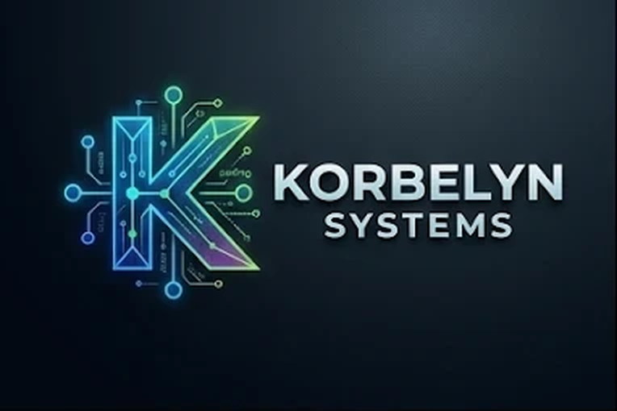

### Software, automation and internal systems — built in Baku

KORBELYN SYSTEMS builds practical software for businesses: products people use every day,
automation that removes manual reporting, and internal systems that connect hardware, data and teams.

## Products

| | Product | What it does | Stack |
|---|---|---|---|
| 🛰️ | [**Orbita**](https://github.com/Korbelyn-Systems/orbita) | AI marketing office: a team of AI agents plans content, audits SEO, watches competitors and learns from results; a human approves what goes out. Client portal, Meta & Telegram channels, video production. | Next.js · TypeScript · Claude API · PostgreSQL |
| ⌨️ | [**Sezryn**](https://github.com/Korbelyn-Systems/sezryn) | Code editor that catches mistakes while you type and fixes them in one key. 9 languages, notebook cells, SQL Server workbench, safe by design. | C# · .NET 8 · WPF · Roslyn |

## What we do
- **Business software** — desktop and web systems, ERP/CRM, reporting desks, hardware integration (scales, card readers, gates).
- **Automation** — turning daily manual reports and data entry into one-click tools.
- **Data & analytics** — SQL, Python and Power BI from raw data to decisions.
- **Mobile** — Android apps built for real field use.

## Principles
- Code stays proprietary: repositories here describe **what a product does and how it is designed**, not the full source.
- Safety first: no destructive action without confirmation, local-first data where possible.

---

Founder: <a href="https://github.com/Dicapso">Tural Zamanlı</a> · <a href="https://dicapso.github.io">Portfolio</a> · <a href="https://linkedin.com/in/dicapso">LinkedIn</a>
